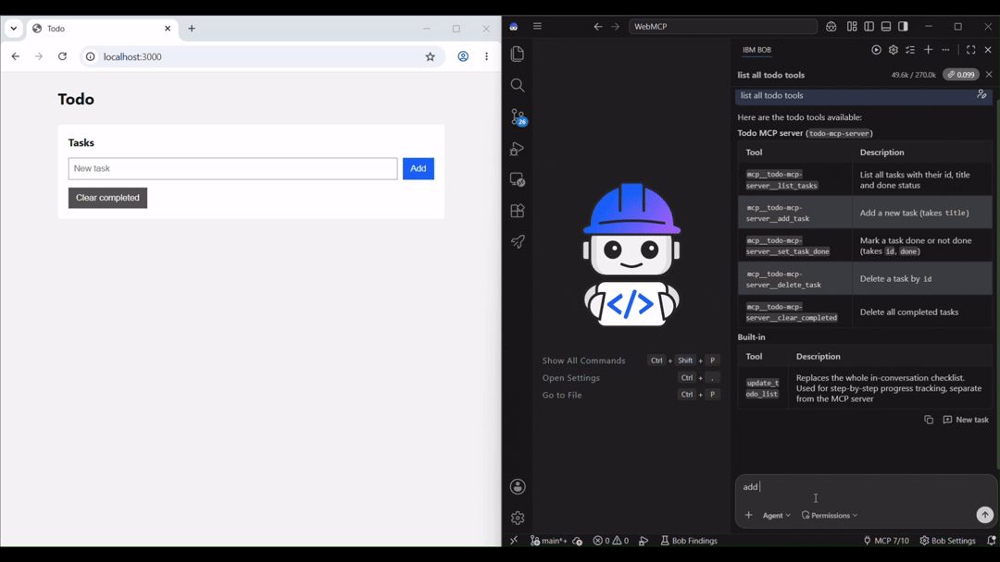
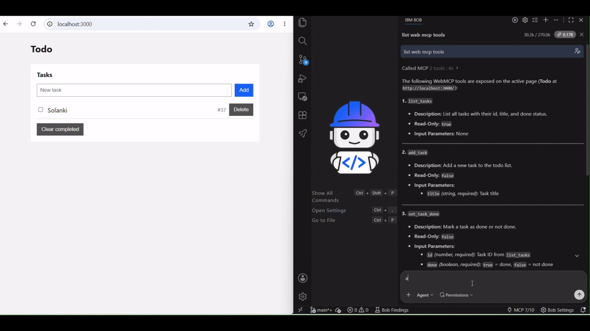

# WebMCP vs Backend MCP: Todo POC

A single-page todo app on localhost that exposes the **same five tools** two ways, so you can see the difference:

| | Backend MCP (`/mcp`) | WebMCP (in the page) |
|---|---|---|
| Tool code runs in | Node server | Browser tab |
| Changes | Saved data only | Live page state **and** saved data |
| Open page updates? | **No**, stale until Refresh | **Yes**, instantly (row flashes) |
| Browser needs to be open? | No | Yes |

Tasks are saved in `data/tasks.json`, so they survive page refreshes and server restarts.

## Demo

**Backend MCP**: the page stays stale until Refresh.



**WebMCP**: the page updates instantly.



## Run

```
npm install
npm start
```

- Web page: http://localhost:3000
- REST API: http://localhost:3000/api/tasks
- Backend MCP: http://localhost:3000/mcp (Streamable HTTP, stateless)

The server binds to `127.0.0.1` only. Set `PORT` to change the port.

## AI Agent MCP Setup

Copy the `mcpServers` block into your MCP-compatible client's config (Claude Desktop, Cursor, VS Code, Bob, etc.).

```json
{
  "mcpServers": {
    "todo-mcp-server": {
      "url": "http://localhost:3000/mcp",
      "type": "http"
    },
    "chrome-devtools": {
      "command": "npx",
      "args": [
        "-y",
        "chrome-devtools-mcp@latest",
        "--categoryExperimentalWebmcp",
        "--chromeArg=--enable-features=WebMCP"
      ]
    }
  }
}
```

| Server | Transport | Purpose |
|---|---|---|
| `todo-mcp-server` | HTTP → `localhost:3000/mcp` | Backend MCP — lets the agent call the five todo tools without a browser |
| `chrome-devtools` | stdio (npx) | Launches a Chrome DevTools MCP bridge with WebMCP support, so the agent can also call the in-page WebMCP tools |

**Steps:**
1. Start the app (`npm start`).
2. Open `http://localhost:3000` in Chrome (the `--enable-features=WebMCP` flag is passed automatically by `chrome-devtools-mcp`).
3. Point your agent at the config above.

The agent now has access to both server sets — use `todo-mcp-server` tools for headless operations, or `chrome-devtools` WebMCP tools to drive the live page.

## Tools

| Tool | Read-only | Input |
|---|---|---|
| `list_tasks` | yes | none |
| `add_task` | no | `{ "title": string }` |
| `set_task_done` | no | `{ "id": number, "done": boolean }` |
| `delete_task` | no | `{ "id": number }` |
| `clear_completed` | no | none (WebMCP version asks the user to confirm) |
